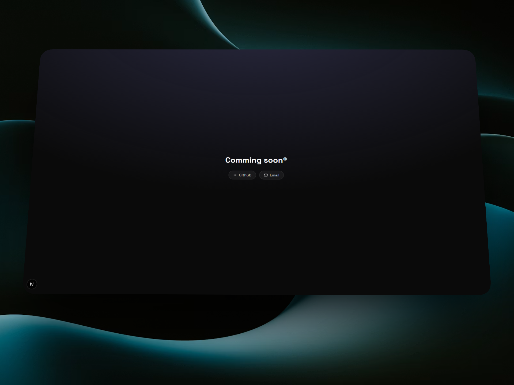

# Sander's Portfolio

Sander's new Portfolio, showcasing projects, skills and a way to get in touch with me.

**URL:** [sander.tf](https://sander.tf/)

## Tech Stack

- Next.JS 16
- TailwindCSS
- Framer Motion
- Markdown
- [Resend](https://resend.com)

## Features
- Responsive design
- Smooth animations
- Markdown based content
- Working contact form

## Getting started

```bash
# install dependencies
npm install
 
# run the dev server
npm run dev
```
 
Open [http://localhost:3000](http://localhost:3000) to view it in your browser.

## Run with Docker

Build and start the production app with Docker Compose:

```bash
docker compose up --build -d
```

The portfolio is available at [http://localhost:3000](http://localhost:3000).
To enable the contact form, set `TURNSTILE_SECRET_KEY`, `DISCORD_WEBHOOK_URL`,
and `RESEND_API_KEY` in a `.env` file in the project root before starting the
container. The `.env` file is not included in the image.
